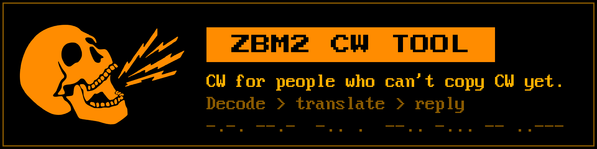
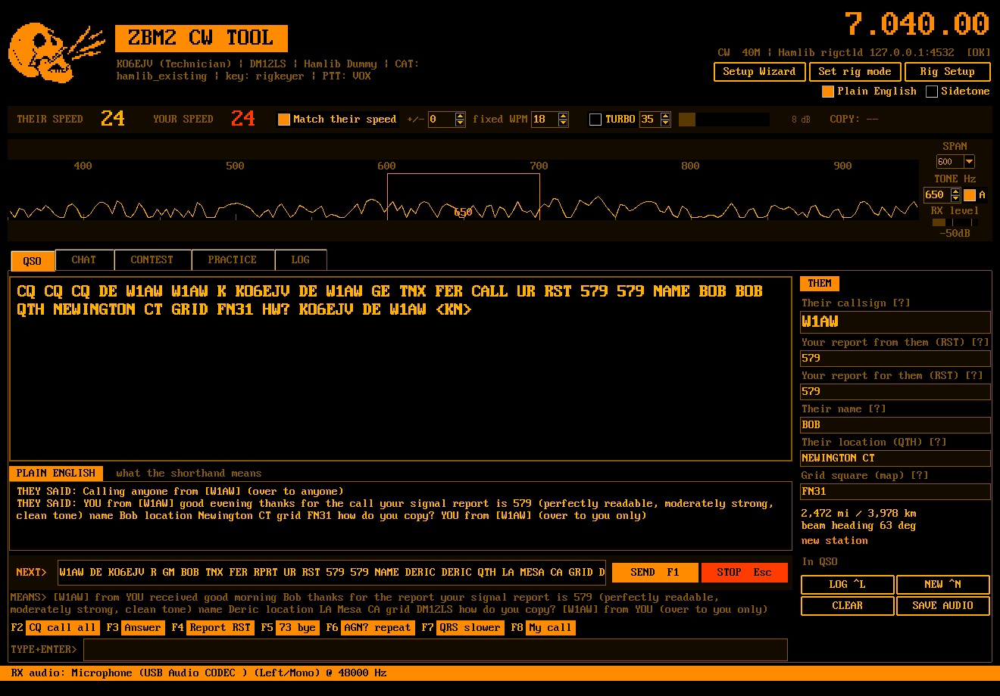
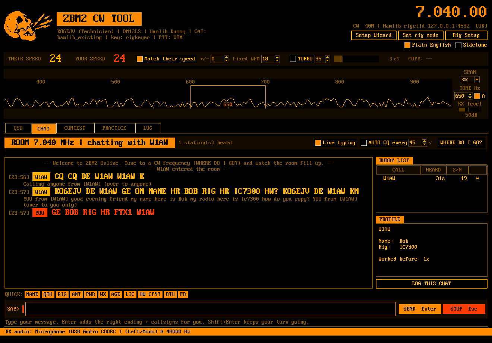
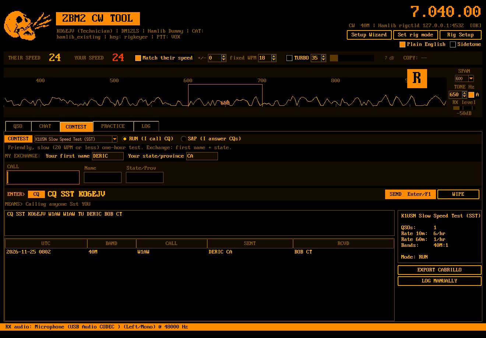
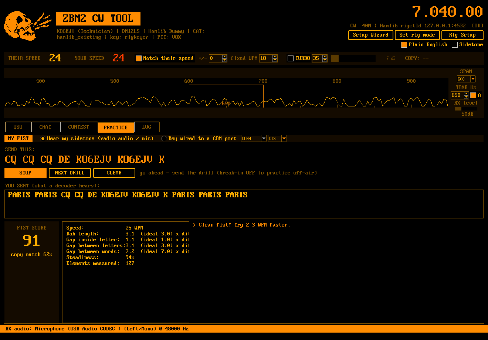
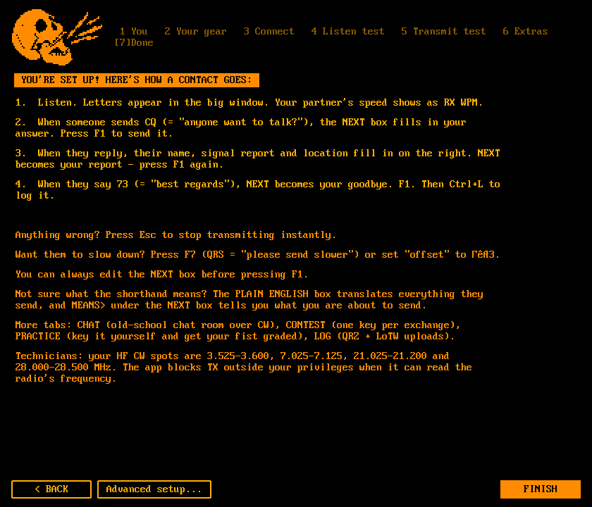
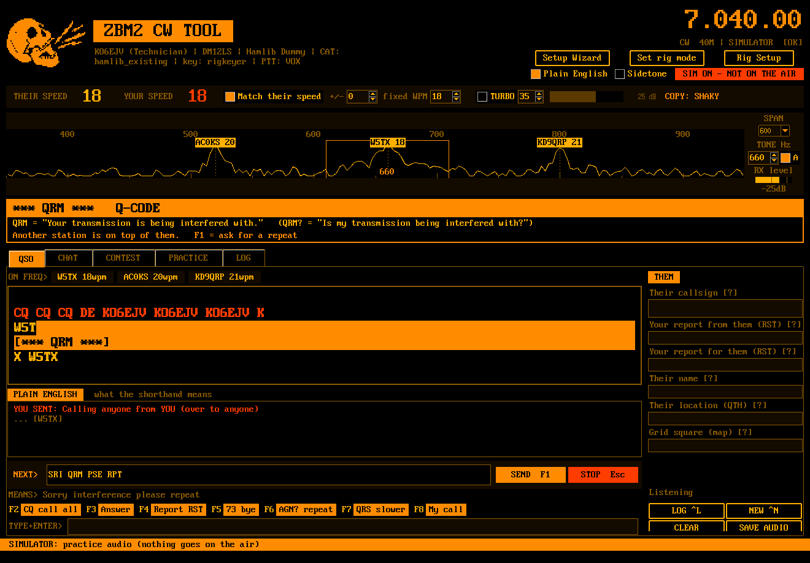
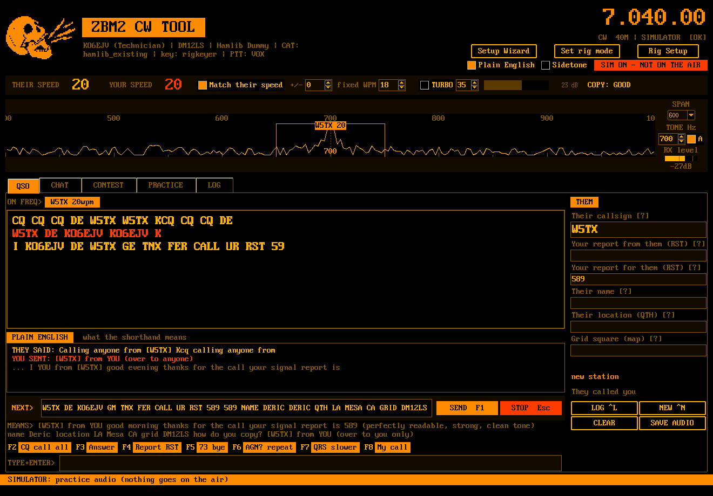
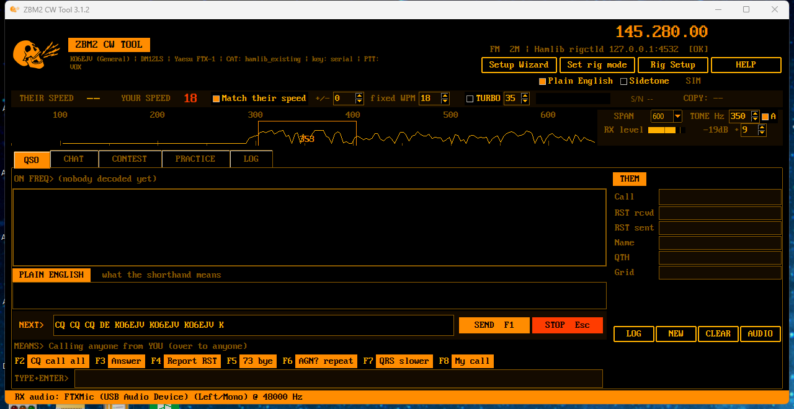

<p align="center">
  
</p>

<p align="center">
  <a href="https://github.com/ko6ejv/zbm2-cw-tool/releases/latest"></a>
  <a href="LICENSE"></a>
  
  
  
  <br>
  <a href="https://github.com/ko6ejv/zbm2-cw-tool/actions/workflows/ci.yml"></a>
</p>

<p align="center">
  <b><a href="https://github.com/ko6ejv/zbm2-cw-tool/releases/latest">Download</a></b> &nbsp;·&nbsp;
  <a href="#what-it-does">Features</a> &nbsp;·&nbsp;
  <a href="#install">Install</a> &nbsp;·&nbsp;
  <a href="#supported-setups-the-wizard-configures-these">Radios</a> &nbsp;·&nbsp;
  <a href="#staying-legal">Staying legal</a>
</p>

# ZBM2 CW Tool

<p align="center"><b>CW for people who can't copy CW yet.<br>Putting competent operators on the net.</b></p>

> **ZBM2** *(Z-code): "Place a competent operator on the net."* This app is the competent operator until you are.

**CW for people who can't copy CW yet.** It decodes Morse from your radio, translates the shorthand into plain English, matches the other operator's speed, and sends your replies for you. Along the way it teaches you the code by ear.

Built for brand-new hams, especially **Technicians**, who have CW-only privileges on 80, 40, 15 and 10 m but have never used them.



## What it does
- **Decodes CW** from 5 to 60 WPM, follows speed changes mid-QSO, handles Farnsworth spacing, and auto-tunes to the tone. You can also click a signal on the spectrum to tune to it.
- **Neural decoder.** Copy is done by the [DeepCW](https://github.com/e04/deepcw-engine) CNN + CTC model (MIT), run locally with onnxruntime and fed only the station you've selected (a 250 Hz slice around its tone). On real band noise it copies 97% of characters at -6 dB and 90% at -9 dB S/N (2.5 kHz), where the classic timing decoder was at 66% and 46%. If onnxruntime or the model is missing, the built-in Bayesian decoder takes over.
- **Pileup mode.** Every CW signal in the passband is decoded at once, even stations only 60 Hz apart. Calls are labeled on the spectrum and listed under **ON FREQ**; click one to work them.
- **SIMULATOR.** Practice stations call CQ, answer you, react to AGN?/QRS, run contest exchanges and form pileups, with optional fading and static. You hear them through your speakers and nothing goes on the air. It works in every tab: click **SIM** or use PRACTICE > Practice QSO.
- **Plain English** under everything: `UR RST 579` → "your signal report is 579 (perfectly readable, moderately strong, clean tone)".
- **Writes your next reply.** The NEXT box fills itself in as the QSO goes: answer → report → 73. **F1** sends it at *their* speed.
- **Ends your overs for you.** It picks K / KN / BK / SK automatically and adds your callsign every 10 minutes and at the end of a contact (Part 97 station ID).
- **Morse earcons:** every sound the app makes is a real CW letter (K = your turn, R = sent, TU = logged). You learn by osmosis.
- **Copy-quality alerts:** `*** QRM ***` / `QSB` / `QRN` / `QRS` banners with the official Q-code definition, plain English, and the right request pre-loaded.
- **TURBO:** if the other station's timing is machine-perfect, it suggests QRQ, so two computers can speed up past a matched speed.
- **License guard:** it won't transmit outside your class's CW segments when it can read the radio's frequency.

| Tab | What it's for |
|---|---|
| **QSO** | Guided contacts: decode, plain English, suggested replies, THEM panel (call/RST/name/QTH/grid, distance, worked-before) |
| **CHAT** | "ZBM2 Online": AOL/Yahoo-style keyboard-to-keyboard rag-chew. The frequency is the room; stations heard go in a buddy list with profile cards, a "W1AW is sending..." indicator, live type-ahead, quick-fill buttons, AUTO CQ, and a **WHERE DO I GO?** list of Tech CW spots |
| **CONTEST** | One key per exchange (Enter Sends Message) for K1USN SST, POTA and ARRL Field Day. Exchange parsing, dupes, rate, Cabrillo export |
| **PRACTICE** | Raw mode: key it yourself. It decodes your sidetone (or a key wired to a COM port) and grades your fist: dah ratio, gaps, steadiness, tips |
| **LOG** | ADIF log, QRZ Logbook + LoTW (TQSL) uploads, LoTW confirmations, 2-minute audio replay recordings |

| | |
|---|---|
|  |  |
|  |  |
|  |  |

## Install

### Windows
Download **ZBM2-CW-Tool-Setup-x.y.z.exe** from [Releases](https://github.com/ko6ejv/zbm2-cw-tool/releases/latest), run it, and the setup wizard opens on first launch. Everything (Python, the decoder model) is bundled, so there's nothing else to install. The **HELP** button (top right) has a one-page quick start; hover over anything for a tip.
A portable zip is also attached if you don't want to install.

### ClockworkPi uConsole (CM4) / Raspberry Pi
A field CW station in your pocket: uConsole + DigiRig + FT-857D / FT-891 (or any radio below).

<p align="center"></p>

On **Raspberry Pi OS 64-bit**, open a terminal and paste:
```
curl -fsSL https://raw.githubusercontent.com/ko6ejv/zbm2-cw-tool/main/install_uconsole.sh | bash
```
It installs everything (Python, the neural decoder, Hamlib, serial-port access) and adds **ZBM2 CW Tool** to the menu. Log out and back in once, plug in the radio, start the app; the Setup Wizard takes it from there. Run the same command again to update.

- The screen switches to a **compact layout** automatically on 720-line screens (force it with `"layout": "compact"` in config.json).
- No F-keys needed: **Ctrl+1 ... Ctrl+8** = F1 ... F8.
- Tested on every change on GitHub's ARM64 machines (installer, tests, and the neural decoder at about 30x faster than real time). CM5 is next.

**Radio hookup** - pick your radio in the Setup Wizard and these are filled in for you:

| Radio | CAT (Hamlib model, speed) | Receive audio | CW is sent by |
|---|---|---|---|
| Yaesu FTX-1 | Radio USB, *Enhanced* port (#1051, 38400) - needs Hamlib 4.7+ | Radio's USB sound card | DTR on the *Standard* port (PC KEYING / RPTT = DTR, semi break-in) |
| Yaesu FT-891 | Radio USB, *Enhanced* port (#1036, menu CAT RATE) | DigiRig on the DATA jack (no USB sound card in the radio) | DTR on the *Standard* port (PC KEYING = DTR, break-in on) |
| Yaesu FT-857D | DigiRig to the CAT jack (#1022, menu 019 CAT RATE, 4800 default) | DigiRig on the DATA jack | Clean CW tone, radio in USB / DIG |
| Yaesu FT-817 / FT-818 | DigiRig to ACC (#1020 / #1041) | DigiRig on the DATA jack | Clean CW tone, radio in USB / DIG |
| Yaesu FT-991A | Radio USB, *Enhanced* port (#1035) | Radio's USB sound card | Radio's keyer |
| Elecraft KX3 | KXUSB / DigiRig serial to ACC1 (#2045, CONFIG RS232) | PHONES to a USB sound card / DigiRig | Radio's keyer (KY), break-in on |
| Xiegu G90 | DE-19 or DigiRig to ACC (#3088, 19200) | Same cable | Clean CW tone, radio in USB |
| Xiegu X6100 | One USB-C cable (#3087, 19200) | Radio's USB sound card | Clean CW tone in U-DIG, PTT by CAT |
| Xiegu X6200 | One USB-C cable (#3091, 19200) | Radio's USB sound card | Clean CW tone in U-DIG, PTT by CAT |
| Xiegu G7250 | Not in Hamlib yet - starts as the X6200 (CI-V); **Update Hamlib** when it's added | Radio's USB sound card | Clean CW tone, PTT by CAT |
| Icom IC-7300 / IC-705 | One USB cable (#3073 / #3085, CI-V USB baud) | Radio's USB sound card | Radio's keyer, break-in SEMI |

Any other radio Hamlib knows (hundreds) works too: pick "Other" and the connection type.

### Updating Hamlib (any version of the app)
**Rig Setup > Update Hamlib** downloads the newest official Hamlib from github.com/Hamlib, checks it against Hamlib's published SHA-256, and installs it in the app's own folder - no admin rights, your old Hamlib stays. On Windows that's a 3 MB download; on Linux / Raspberry Pi it is built from source (about 15 minutes on a CM4; needs `sudo apt install build-essential` once). From a terminal: `python hamlibupd.py`. The Setup Wizard offers the same thing as **Install Hamlib now** when no Hamlib is found. OmniRig users: OmniRig is still supported (Windows); update it from its own site, there's a button in Rig Setup.

### From source (Windows / Linux; macOS should work but is untested)
```
# Windows
install.bat      (once)
start.bat

# Linux
sudo apt install python3-venv python3-tk libportaudio2
./start.sh
```
Needs Python 3.10+. On Linux, add yourself to the `dialout` group for serial ports: `sudo usermod -aG dialout $USER`.

## Supported setups (the wizard configures these)
| Setup | Rig control | How CW is sent | PTT |
|---|---|---|---|
| Radio with built-in USB (Yaesu FTX-1 / FT-991A / FT-710, Icom IC-7300 / IC-705, Kenwood TS-590…) | Hamlib (the app runs rigctld) | Radio's internal keyer | Break-in |
| Already running rigctld or OmniRig | Existing rigctld / OmniRig | Radio keyer, or serial / audio | Any |
| DigiRig + HF radio (FT-857, FT-817/818, FT-891…) | Hamlib via DigiRig | Shaped audio tones (DATA/USB) | DigiRig RTS |
| DigiRig + BTECH UV handheld | None | Tone CW over FM (MCW) | DigiRig RTS (350 ms lead) |

**Yaesu FTX-1:** CAT `KY` text doesn't key this radio. Key CW with **DTR on the Standard COM port** (RADIO SETTING → PC KEYING → RPTT SELECT = DTR) with semi break-in on, and use the Enhanced COM port for CAT. The app turns break-in on for you.

The Rig Setup screen works like Winlink Express / VARA / WSJT-X:
- Radio list from Hamlib, COM port, baud, handshake, DTR/RTS
- CW keying: CAT / DTR / RTS / audio
- PTT: CAT / RTS / DTR / VOX
- Audio device per Windows audio system, with L/R channel, TX drive, Tune, and PTT lead/tail

## Integrations
- **GridTracker** (WSJT-X UDP protocol on port 2237): status, heard stations, and logged QSOs.
- **QRZ.com XML** (subscription) or **HamQTH** (free) callsign lookups fill in name, QTH and grid automatically.
- **QRZ Logbook** API upload, and **LoTW** upload through your own TQSL certificate, plus confirmation download.

## Staying legal
Nothing transmits without a keypress from you. AUTO CQ is something you turn on and supervise, so you stay the control operator. The app adds station ID for you and refuses to transmit outside your license class's CW segments when CAT is connected.

## Field use / headless
Everything runs offline on the field PC; QRZ, HamQTH and LoTW are optional extras.
The radio **engine** (`engine.py`) is separate from the screens. On a box with no display (a Pi, a Jetson, an SSH session), run:
```
python main.py --headless          # decode to the console, type to send (endings + ID added for you)
python main.py --headless --sim    # same, against the simulator
```

## Development
```
python -m pytest tests/test_all.py      # decoder, weak-signal, pileup, QSO logic, endings, contest, grader, simulator, parsers
python tests/weak.py                    # accuracy vs signal-to-noise table
python decode_wav.py some.wav           # decode a recording
```
Layout: `engine.py` (radio work: audio, decoders, skimmer, rig, TX, alerts, logging) · `app.py` + `tab_*.py` (screens)
· `main.py` (boot screen + launcher) · `simulator.py` (practice stations) · `config.py` (settings; passwords go in the OS credential store).
Pushing a tag like `v3.0.0` makes GitHub Actions run the tests and build the Windows app with PyInstaller. It then packages it with Inno Setup and attaches the installer and portable zip to a Release.

## Callsign database (optional)
Garbled calls are corrected against calls heard this session and, if present, **MASTER.SCP** (Super Check Partial). Download it from [supercheckpartial.com](https://www.supercheckpartial.com/) and drop it in `data/`.

## Credits
- CW decoding model: **DeepCW** by e04 ([deepcw-engine](https://github.com/e04/deepcw-engine)), MIT. Model in `models/`, license in `models/DEEPCW_LICENSE.txt`; stitching code vendored in `deepcw_engine.py`.
- Font: **Px437 IBM VGA 8x16** from *The Ultimate Oldschool PC Font Pack* by VileR ([int10h.org](https://int10h.org/oldschool-pc-fonts/)), CC BY-SA 4.0. See `fonts/`.
- Hamlib, TrustedQSL, GridTracker, QRZ.com and HamQTH are their respective owners' projects.

ZBM2® is a trademark of ZBM2 Industries.
